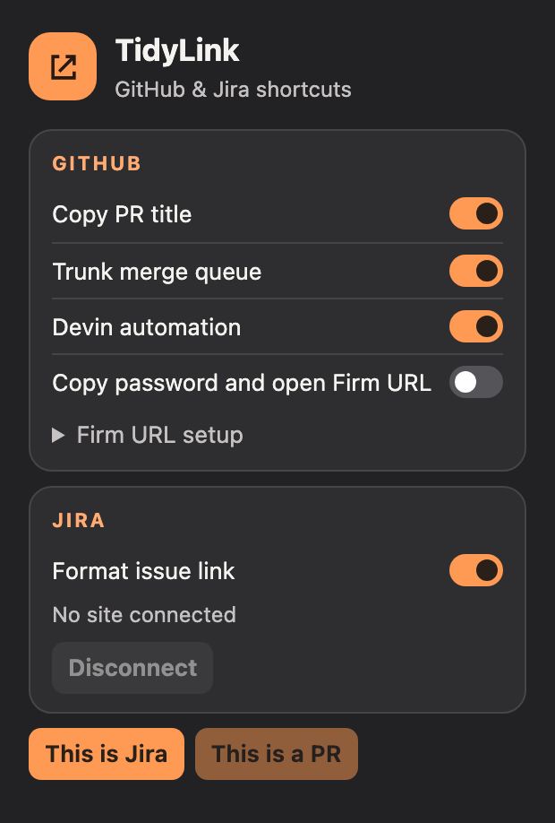
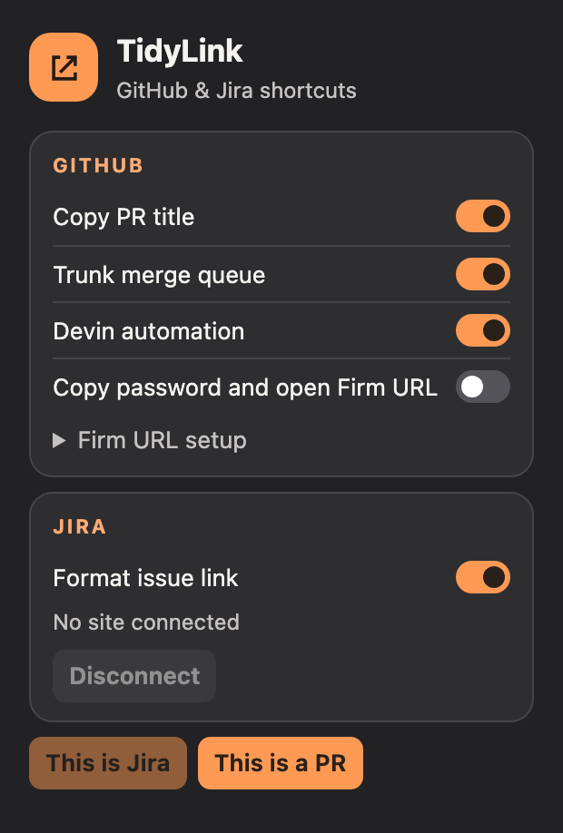
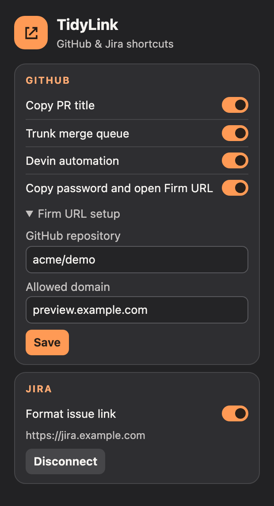

# TidyLink — GitHub & Jira Shortcuts

**Clean links for busy teams.**

An extension for **Firefox, Microsoft Edge, Google Chrome, and compatible Chromium-based desktop browsers** that copies pull request and Jira issue titles as clickable links. It also adds GitHub shortcuts for managing the merge queue, toggling Devin automation, and opening test environments.

## Features

| Where | Action | What it does |
| --- | --- | --- |
| GitHub · PR header | **Copy PR title as a link** | Copies the title as a link to the main PR page. The title omits the PR number, and the URL omits tab paths, query parameters, and fragments. |
| GitHub · PR header | **Trunk** | Adds the PR to the merge queue or cancels the request from **Conversation** when the PR has a Trunk comment. |
| GitHub · PR header | **Devin** | Toggles PR automation when the corresponding control is available in Devin's comment. |
| GitHub · PR header (all tabs) | **Copy password and open Firm URL** | Appears on PRs in the configured repository. On click, reads the GitHub Actions comment from **Conversation**, copies the test-environment password, and opens the environment URL in the same tab. If no matching comment is found or copying fails, the tab stays on the PR. Off by default. |
| Jira · issue breadcrumb | **Format Link** | Copies `DEMO-101: Issue title` as a direct link to the issue. Works on the issue page and in the board's issue view. The button appears when you hover over the issue key or navigate to it with the keyboard. |

**Pasting links:** rich-text editors receive a clickable link. Plain-text fields receive only the title (plus the issue key for Jira). The buttons indicate whether copying succeeded.

## Installation

### Chrome, Edge, and other Chromium browsers

1. Clone the repository or select **Code → Download ZIP** on GitHub and extract the archive.
2. Open your browser's extensions page (`edge://extensions` in Edge, `chrome://extensions` in Chrome, or `brave://extensions` in Brave) and turn on **Developer mode**.
3. Select **Load unpacked** and choose the folder containing [`manifest.json`](manifest.json).
4. Open your browser's **Extensions** menu and pin **TidyLink — GitHub & Jira Shortcuts** to the toolbar.
5. **Reload any GitHub or Jira pages you already had open** (`Ctrl+R` on Windows/Linux, `⌘R` on macOS). For Jira, follow the connection steps below first.

**To update:** download the changes, open your browser's extensions page, and select **Reload** on the extension card. **Then reload the GitHub or Jira page itself.** Reloading the extension does not reload pages that are already open.

### Firefox

1. Clone the repository or download the GitHub ZIP and **extract it first**. GitHub's source ZIP has `manifest.json` inside a project folder, so loading the ZIP directly gives a “does not contain a valid manifest” error in Firefox-based browsers, including Zen.
2. In desktop Firefox 128 or later (or a compatible Firefox-based browser), open `about:debugging#/runtime/this-firefox`, select **Load Temporary Add-on**, and choose the [`manifest.json`](manifest.json) file inside the extracted `tidy-link-main` folder.
3. If prompted, grant access to GitHub. Open TidyLink from the **Extensions** menu to connect Jira, then **reload any GitHub or Jira tabs you already had open**.

To update during the same session, select **Reload** on the TidyLink card in `about:debugging`, then reload the affected web pages. This temporary install is removed when Firefox restarts. A persistent install in standard Firefox requires a Mozilla-signed add-on.

## Toolbar settings

Click the **TidyLink** icon in your browser's toolbar to open settings. Each switch shows or hides its corresponding button on GitHub or Jira; it does not perform the action itself. Orange means on, and gray means off. Settings are saved in your browser.

After setup, shortcuts load automatically when you open a supported page. You do not need to open the toolbar popup again. Hover over a shortcut or focus it with the keyboard to see a tooltip styled for GitHub or Jira.

### Connect Jira

1. Open a page on your Jira site and click the **TidyLink** icon.
2. Select **This is Jira** at the bottom of the popup. It uses the current tab's HTTPS origin as the base URL. Grant access when your browser prompts you. The connected URL appears in the popup, and the setup button disappears.
3. **Reload the Jira page**, then open an issue. Hover over the issue key or use the keyboard to reach **Format Link** in the issue breadcrumb.



### Set up Firm URL on GitHub

1. Open the **Conversation** tab of a PR with a GitHub Actions comment containing an HTTPS `Firm Url` link and a `Password` in inline code. **Reload the PR page first** if it was open before you installed or updated the extension.
2. Click the extension icon and select **This is a PR** at the bottom. It saves the repository and the exact hostname from the comment's link, turns on the shortcut, and hides the setup button. If there is no matching comment, your settings stay as they are.
3. **Reload the PR page** and look for the key icon in the PR header. Click it when you want to copy the password and open the environment.



### Change settings after setup

| Popup control | What it does |
| --- | --- |
| **Copy PR title**, **Trunk merge queue**, **Devin automation**, **Copy password and open Firm URL**, **Format issue link** | Show or hide the corresponding page buttons described in [Features](#features). |
| **Firm URL setup → Save** | Set or edit the repository and allowed domain manually. If environments use different hostnames under a shared domain, enter that domain here. The shortcut accepts it and its subdomains. |
| **Disconnect** | Removes the Jira connection and revokes access to that site. Reload the Jira page. To connect a different site, open it and use **This is Jira** again. |

The setup buttons are hidden once their respective settings are saved. The screenshot below shows both configured, with **Firm URL setup** expanded. All screenshots use example data.



## Permissions and compatibility

- **Browser support:** Firefox and Chromium share the same Manifest V3 codebase. To install directly from this repository, use the temporary add-on loader in Firefox or **Load unpacked** in Chromium.
- **Clipboard (`clipboardWrite`):** writes to the clipboard when you click a copy button. The extension does not read the clipboard or keep a copy history.
- **Site access (`scripting`):** the script runs on `github.com` by default. Jira support runs only on the HTTPS domain you authorize. GitHub Enterprise Server on custom domains is not supported.
- **Active tab (`activeTab`) and settings (`storage`):** the popup reads the current tab's URL to connect Jira and saves your settings locally.
- **Trunk and Devin** use GitHub's controls through your current session. The extension has no analytics, runtime dependencies, or build step.

## Development and testing

After editing the code, reload the extension and then reload the tab where you are testing.

```sh
node --check content.js
node --check options.js

TEST_DEPS=$(mktemp -d)
npm install --prefix "$TEST_DEPS" --no-package-lock --no-audit --no-fund jsdom@26
NODE_PATH="$TEST_DEPS/node_modules" node tests/check.cjs
```

The tests use representative pages and fictional data to verify link copying, navigation between Jira issues, and copying the password before opening **Firm URL**. To run the GitHub scenario in headless Edge, run `python3 tests/check.py`. If Edge is not at the default macOS path, set `EDGE_BINARY` to the browser executable.
